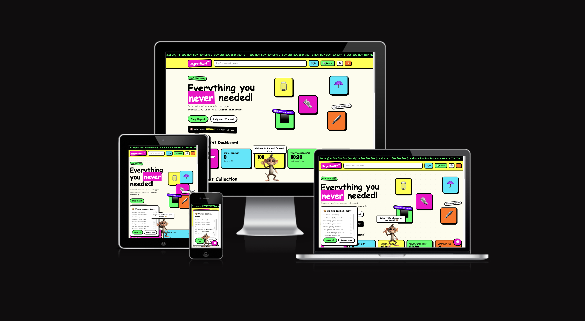

  

# RegretMart

A satirical "world's worst online store". Plain HTML + CSS + vanilla JS — no build step, no dependencies.

## Run
Just open `index.html` in a browser, or serve the folder:

    python3 -m http.server 8000

## Structure
    index.html        page markup
    css/styles.css    all styles (brutalist theme + sanity mode)
    js/products.js    product data + helpers (inr, toRoman)
    js/sound.js       sound effects + voice (Web Audio / Speech Synthesis)
    js/app.js         cart, search/sort, popups, Gary chat, monkey, sanity mode
    images/monkey.png Bandar the monkey
    favicon.ico

## Easter eggs
- Click the **RegretMart logo**: gravity switches on and everything on screen falls, bounces and piles up at the bottom (with a thud). "🍎 Undo gravity" or clicking the logo again puts it all back. Does nothing in Sanity Mode.
- Konami code, the "Help me, I'm lost" button, or `?sanity=1` toggles Sanity Mode.

- **Hero items do what their icon does** (click or press Enter): ☂️ makes it rain and every item gets wet (click again or press ☀️ Stop rain), 🫙 opens and nothing comes out, 👟 kicks, ⬛ tries to roll and goes nowhere, 🖊️ writes by itself. Does nothing in Sanity Mode.

## Fire
- Press **🔥** in the header (next to the sound button): every item catches fire, smoke slowly fills the whole site (it is see-through and you can still click through it) and everything falls to the bottom, like gravity. The button turns into 🧯: press it to put the fire out. Clicking the ☂️ umbrella (rain) also puts it out. Items stay fallen until you press "Undo gravity". Hidden in Sanity Mode.

## Footer banner
- A big **Vibehack'26** made of thin scan-lines sits in the footer: the lines keep drifting, a bright band sweeps across the letters and smoky blobs float behind. It lives in `index.html` (`.vibe-banner`) and `css/styles.css`; change the text inside the `<text>` tag (and the `aria-label`). Hidden in Sanity Mode, frozen with reduced motion.

## Cart list
- Click the **🛒** in the header to open the checkout list: every item added, quantity and price per line. Close with ×, Esc or a click outside.
- **Overprice:** the list opens at the product-page price, then the total climbs. Each item gets a markup with a silly reason (`OVERPRICE` in `js/products.js`), extra charges are added (`CHECKOUT_FEES`), and the list shows the % overpriced and the biggest culprit. Sanity Mode shows honest prices.

## Reveal Mode (dark pattern X-ray)
- Press **🔍 Reveal** in the header (or add `?reveal=1` to the URL). Every deliberate dark pattern gets a dashed outline and a label, e.g. "Fake urgency", "Bhaagta button", "Confirmshaming", "Cookie overload".
- A "field guide" section at the bottom explains what each trick is called in the real world.
- Labels follow elements as they move or scroll, and are hidden for anything covered by a pop-up.
- Press `Esc` or "Turn off" to leave. To add a new label, add an entry to `TARGETS` (and `PATTERNS` for a new type) in `js/app.js`.
- Tip for demos: `?reveal=1` also labels the splash pop-up, because the pop-up blocks the 🔍 button until it is closed.
